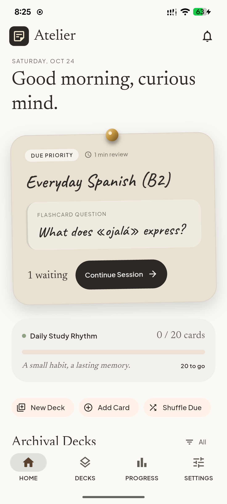
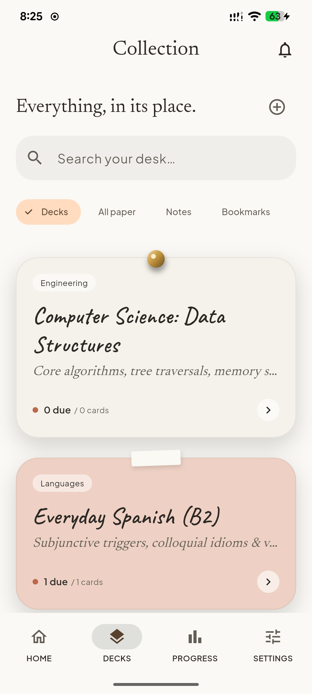
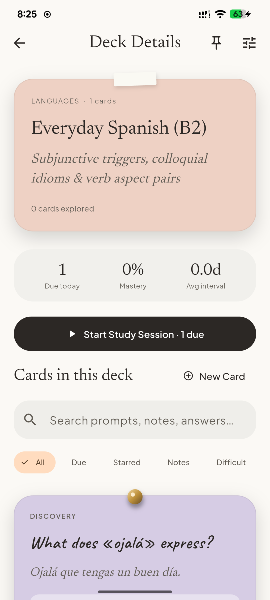
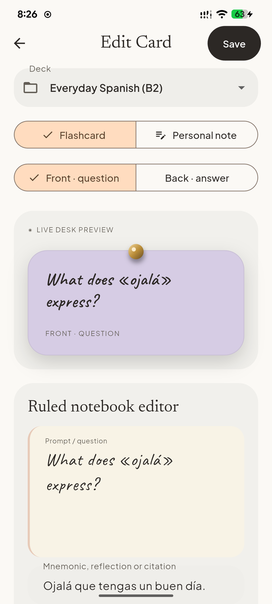
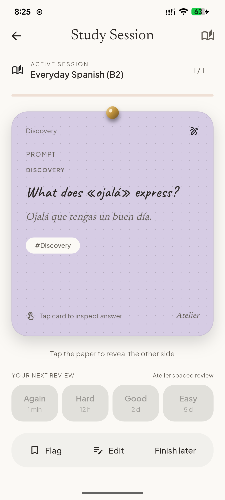
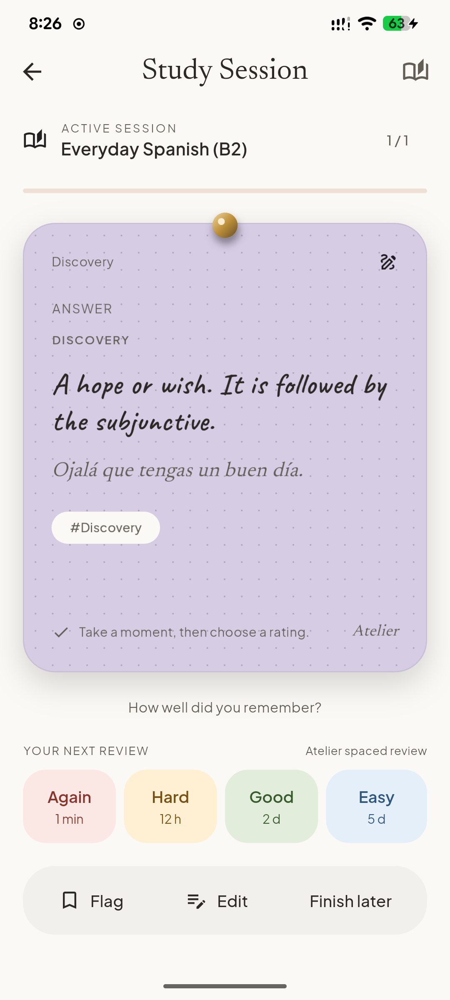
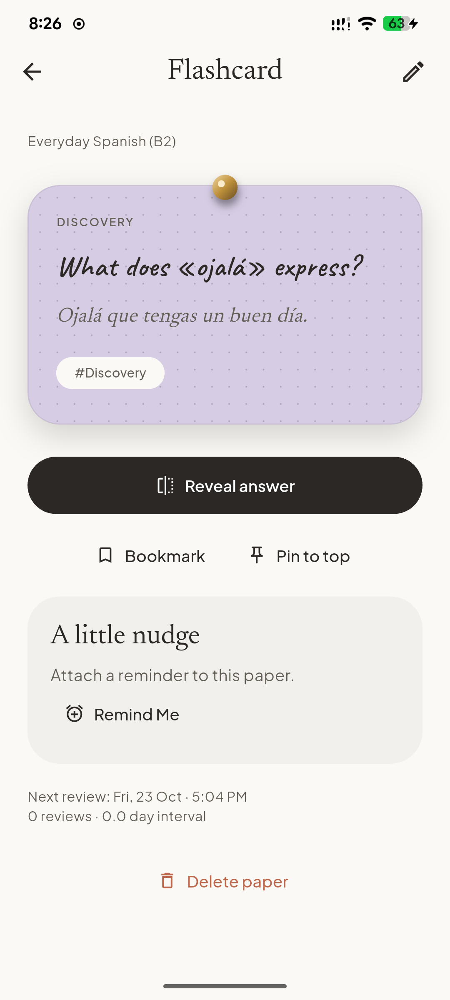
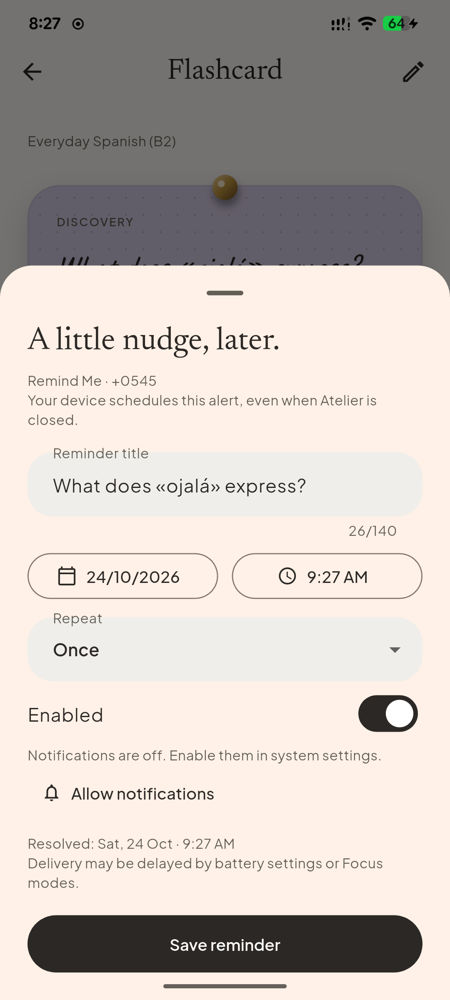
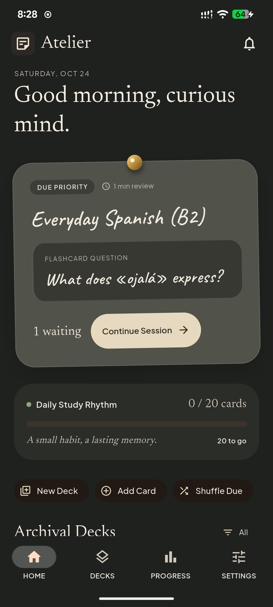

# Atelier

A private, offline Flutter desk for handwritten flashcards and personal notes.
Warm paper, charcoal ink, pinned cards and sticky notes turn everyday study into
a small stationery ritual. Built from the supplied Stitch references with real
Flutter widgets, locally bundled fonts and paper sounds.

[Screenshots](#screenshots) · [Demo walkthrough](#uiux-demo-walkthrough) · [Run locally](#run) · [Verification](docs/VERIFICATION.md)

## Screenshots

Captured from the connected **2201117TG Android phone** on **24 October 2026**,
running Atelier **1.0.0**. These are unretouched **1080 × 2400** device screenshots.
Click any image to inspect it at full size.

<table>
  <tr>
    <th>Home · Warm daylight</th>
    <th>Deck collection</th>
    <th>Deck details</th>
  </tr>
  <tr>
    <td><a href="docs/demo/home-light.png"></a></td>
    <td><a href="docs/demo/collection-light.png"></a></td>
    <td><a href="docs/demo/deck-light.png"></a></td>
  </tr>
  <tr>
    <th>Handwritten editor</th>
    <th>Study · Front</th>
    <th>Study · Revealed answer</th>
  </tr>
  <tr>
    <td><a href="docs/demo/editor-light.png"></a></td>
    <td><a href="docs/demo/study-front.png"></a></td>
    <td><a href="docs/demo/study-back.png"></a></td>
  </tr>
  <tr>
    <th>Card details</th>
    <th>Remind Me sheet</th>
    <th>Home · Evening desk</th>
  </tr>
  <tr>
    <td><a href="docs/demo/card-detail-light.png"></a></td>
    <td><a href="docs/demo/reminder-sheet.png"></a></td>
    <td><a href="docs/demo/home-dark.png"></a></td>
  </tr>
</table>

More views: [native keyboard and caret](docs/demo/editor-keyboard.png) ·
[appearance and motion settings](docs/demo/settings-light.png).
See [capture notes](docs/demo/README.md) for device details and screenshot scope.

## UI/UX demo walkthrough

A five-minute tour of the working app:

1. **Find your place.** Start on Home, point out the priority review and daily
   rhythm, then open Decks. Compare pinned paper and sticky appearances, search
   the collection, and open a deck.
2. **Make a card or note.** Choose New Card, enter a short prompt and answer,
   switch Front/Back and inspect the live preview. Show Personal note for
   single-sided writing, choose Pinned or Sticky, and save a clearly named demo item.
3. **Study the paper.** Start a study session and tap the card to reveal it.
   Explain the Again/Hard/Good/Easy choices, then rate the demo card and finish
   the session to show completion and persistent progress.
4. **Set a gentle nudge.** Open the demo item and choose Remind Me. Show the local
   date/time and repeat controls. Request notification permission in context if
   alerts are part of the presentation. The screenshot above shows notifications
   turned off; no reminder was saved during capture.
5. **Personalize the desk.** Switch Warm daylight/Evening desk, compare handwriting
   with Clean print, adjust text size, and show Full/Reduced/Minimal motion.
   Preview the paper sound with the device's normal audio settings.
6. **Delete and undo.** On the disposable demo item, explicitly confirm deletion
   to demonstrate Paper Shred or Paper Crumple, then use Undo to restore it.

For the live presentation, include typing, a card flip and one confirmed deletion:
static screenshots cannot demonstrate motion or sound. Use Full motion for the
stationery effects, or Reduced/Minimal motion when preferred by the device or
audience. OS reduced-motion settings are respected.

Install the [Android demo APK](delivery/Atelier-android-release.apk) or follow the
local setup below. It uses development signing. Creation and study need no
account or connection; task alerts need OS notification permission.

## Run

Built with Flutter **3.47.0 / Dart 3.13.0**. Install a current Android SDK (compile
SDK 36), Android Studio/JDK and accept SDK licenses. Dependencies and all runtime
fonts/sounds are bundled; `pub get` needs the network only for initial setup.

```powershell
flutter pub get
flutter run -d <android-device-id>
flutter build apk --release
```

On macOS with Xcode, open `ios/Runner.xcworkspace`, choose your signing team, then
run `flutter run -d <ios-device-id>`. iOS platform configuration is included;
Windows cannot compile or validate the iOS binary. This demo repository includes
Android and iOS platform projects. OS reminders support Android/iOS only.

No environment variables, credentials, account, backend, API keys or runtime
network access are required. The Android release manifest has no INTERNET
permission. The debug/profile manifests allow Flutter tooling connections.

## Your desk

- Home priority review, collection, deck details, global search, tags and filters.
- Create/edit decks, two-sided flashcards and single-sided personal notes.
- Five paper tints, Pinned or Sticky appearance, local images, bookmarks and a
  **separate** pin-to-top action. Appearance never changes list priority.
- Native handwriting editor, optional clean print, adjustable card size, hints,
  live preview and a brief caret-adjacent pen nib. Paste/selection/IME remain native.
- Reveal-gated Again/Hard/Good/Easy study sessions, durable due dates, completion,
  daily goal and review history. Practice a deck even when nothing is due.
- Local deterministic reminder detection, visible inspect/dismiss control,
  dedicated Remind Me sheet, date/time pickers, once/daily/weekly, edit, enable,
  disable, snooze and delete; upcoming and past/disabled lists.
- Light/dark/device themes; Full/Reduced/Minimal motion; OS reduced motion;
  master sound, volume and a separate writing-sound setting, all persistent.
- Explicit deletion with captured-paper Shred/Crumple, storage-failure rollback,
  duplicate guards and Undo restoring the entry and relationships.

The sample library contains four decks, six flashcards and one personal note.
All counts and progress derive from actual stored data. The review scheduler is
**Atelier spaced review**, not FSRS: Again 1 minute, Hard 12 hours, Good 2 days,
Easy 5 days initially; subsequent intervals grow by 1.2/2.3/3.2, capped at one
year. Each session visits its initial queue once. Again remains due a minute later.

## Reminders

Examples: `Submit assignment at 4 pm`, `Call Alex tomorrow at 10 am`, and
`Remind Me: Submit assignment — 2026/10/29, 4 pm`. Year-first dates, am/pm times,
today/tomorrow and bracketed variants are supported. A time without a date uses
the next occurrence, with the resolved day shown. A date without a time asks for
one unless a default exists. Questions and quoted educational examples do not
create alerts. Ambiguous, unsupported and explicit past dates need clarification.

Alerts use OS-scheduled local notifications. Grant permission from Reminders or
the reminder sheet when you choose to use them. A denied state is visible;
saved reminders can be scheduled after permission is granted. Android uses
inexact alarms and respects battery/DND restrictions. Delivery is not guaranteed
to the exact minute. An Android **force-stop** suppresses alarms until relaunch.
At most 48 OS requests are queued; reopen Atelier to replenish longer queues.

Undo of a deleted item restores its original reminder disabled if its saved
occurrence expired. It never creates an immediate expired catch-up alert.
Study due dates do not create additional task alerts.

See [supported grammar, notification lifecycle, platform setup and official
documentation](docs/REMINDERS.md).

## Local data and assets

SQLite stores decks, entries, reviews, reminders and preferences in private
application support storage. Images are copied into its `media/` directory, with
picker resize bounds of 1600×1600. Deletion retains image files so Undo can restore
them. Unreferenced attachments are not yet garbage-collected. Uninstalling the app
can remove local data; there is no cross-device sync or backup/export UI.

[Design audit and schema](docs/DESIGN_AUDIT.md) describe transactions, motion,
performance bounds and the comparison with each reference screen.

Fonts: **Caveat, Newsreader, Plus Jakarta Sans**, SIL OFL 1.1; full notices ship
under `assets/fonts/`. Sound recordings are CC0, credited to Luckius, lmbubec,
moai15, Jarebear1223 and aunrea. Real paper, tack, tape, writing and shredder
recordings are trimmed and normalized. Sticky attachment is explicitly an edited
reverse-peel approximation. Save/completion are original quiet feedback tones.
No unrelated placeholder effects are labeled as paper foley.

[Asset licenses](assets/LICENSES.md) and [source/hash manifest](assets/asset_manifest.json).
All paper, pins, tape, dots and icons are drawn locally. Runtime downloads are
absent. Fonts, sound excerpts and launcher icons are included ready to use.
Minimal license metadata is retained instead of full third-party HTML.
See [source security](docs/SOURCE_SECURITY.md).

## Checks

```powershell
dart format --output=none --set-exit-if-changed lib integration_test test_driver
flutter analyze
flutter drive --driver=test_driver/integration_test.dart --target=integration_test/app_test.dart -d <device-id> --profile --keep-app-running
flutter build apk --release
```

The verification report records the host and device checks performed on this
app. The included device integration fixture adds clearly named test notes and two near-future
delivery-probe reminders to the app's own database. Use a test install; remove
those probe notes when finished. It records screenshots and frame timings under
`docs/device/`. Host screenshots are in `docs/screenshots/`.

The Android APK is signed with the local development key for testing. Configure
your own release signing before publishing to a store. `--keep-app-running` is
needed for host-side notification checks; Flutter drive otherwise removes its
test install when it finishes.

See [verification evidence and remaining platform limits](docs/VERIFICATION.md)
for checks actually completed, device measurements and delivery results.

Troubleshooting: enable notifications in OS settings if denied; check the task
channel, Focus/DND and vendor battery restrictions if an alert is late. Reopen the
app after changing timezone or permission to reconcile records. If a storage
write fails, retain your form and retry; destruction is never used as success
feedback for a failed deletion. A notification error does not erase local notes.
